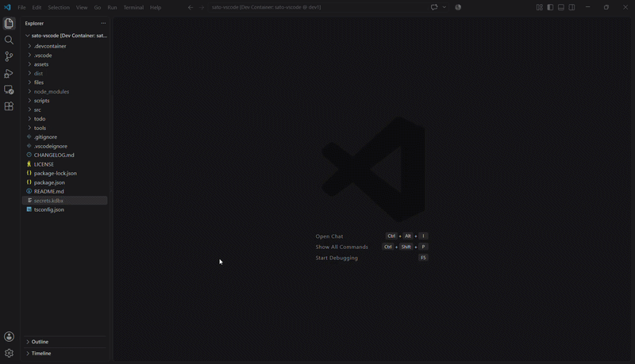

# SATO - Secure Access Task Operator for VS Code

Open, browse, edit and manage vaults (`.kdbx`, `.psafe3`, `.ibak`), supported archives, ZIP-based application containers and common [crypto files](#supported-formats) directly inside VS Code `v1.120.0+` with a single UI.

> **⚠️ Status:** In development!⚠️ Use in production environments at your own risk!⚠️

> **💬 Feedback:** Bugs? Questions? Suggestions? Welcome to [GitHub](https://github.com/Marcus-Aprelius/sato-vscode/issues).

---

---

<!-- Password vaults -->

<!-- Private and public keys -->

<!-- Certificate and key containers -->

<!-- Encryption and secure containers -->

<!-- Archives and disk images -->

---

## Security Considerations

- Passwords are retained only for the active session and are not persisted
- Temporary decrypted data created for Preview or external CLI operations is stored in restricted temporary locations and removed after the operation
- Supported editable vaults are encrypted again when saved
- OpenPGP operations use an isolated temporary GPG home and do not import keys into the user's default keyring
- Clipboard auto-clear and vault auto-lock are configurable
- SATO does not use cloud services or collect telemetry
- Archive entry paths are validated before extraction to prevent directory traversal
- Existing destination files are not overwritten during archive extraction
- Optional `<archive-name>.bak` backups can be created before supported archive modifications
- Archives handled by external CLI tools are inspected and extracted through temporary directories
- Missing optional external tools disable only the formats or operations that depend on those tools; built-in features remain available

---

## Usage

1. Open file of any [supported format](#supported-formats).

2. For vault files and supported password-protected archives, enter the password when prompted.

3. For crypto containers, use `Tools` → `Unlock Container` or the details pane button.

4. Use the toolbar or right-click context menus to manage entries, groups, files, folders.

5. Select the SATO interface theme from `View` → `Theme`.
 
6. Use `Tools` → `Lock Database` to lock a password vault.
 
7. Commands available from the Command Palette `Ctrl/Cmd + Shift + P`:

  * `SATO: Open Password Vault`
  * `SATO: Lock Vault`
  * `SATO: Reload Vault`

---

## SATO Supported Formats And External Tools

### Supported Formats

| Format        | Description                                                  | `SATO` Base Actions                            |
|---------------|--------------------------------------------------------------|------------------------------------------------|
| `.kdbx`       | KeePass `vault` database                                     | Read, write                                    |
| `.psafe3`     | Password Safe `vault` database                               | Read, write                                    |
| `.ibak`       | Password Safe backup `vault`                                 | Read, write with caution                       |
| `.1pif`       | 1Password Interchange Format `vault` export                  | Read-only (RO)                                 |
| `.bcup`       | Buttercup `vault`                                            | Read-only (RO)                                 |
| `.crt`        | X.509 `certificate`                                          | View and convert PEM/DER files                 |
| `.cer`        | X.509 `certificate` in PEM or DER encoding                   | View and convert PEM/DER files                 |
| `.der`        | DER-encoded X.509 `certificate`                              | View and convert to PEM                        |
| `.pem`        | PEM `certificate`, CSR, public key, or private key (PK)      | View, unlock PKs, and convert X.509 files      |
| `.p8`         | PKCS#8 private `key`                                         | View                                           |
| `.pk8`        | PKCS#8 private `key`                                         | View and unlock                                |
| `.key`        | PEM-encoded private `key`                                    | View and unlock                                |
| `.age`        | Encrypted `file` with encoding and protection type detection | RO inspection; View, change password (Linux)   |
| `.pub`        | Ed25519 RSA, ECDSA, or OpenSSH public `key`                  | View metadata and SHA-256 fingerprint          |
| `.rsa`        | Private or public RSA `key` in PEM or DER encoding           | View metadata and supported PK content         |
| `.ec`         | Private or public EC `key` in PEM or DER encoding            | View, convert, and extract public keys         |
| `.csr`        | Certificate Signing `Request` (`CSR`)                        | View                                           |
| `.p10`        | PKCS#10 `Certificate Signing Request` (`CSR`)                | View                                           |
| `.p12`        | PKCS#12 certificate and PK `container`                       | View, unlock, and show PK                      |
| `.pfx`        | PKCS#12 certificate and PK `container`                       | View, unlock, and show PK                      |
| `.p7b`        | PKCS#7 certificate `chain`                                   | View                                           |
| `.p7c`        | PKCS#7 certificate `chain`                                   | View                                           |
| `.p7s`        | PKCS#7/CMS digital `signature`                               | View                                           |
| `.p7m`        | S/MIME or PKCS#7/ CMS `message`                              | View                                           |
| `.spc`        | PKCS#7/CMS Authenticode `container`                          | View certificates, signatures and CMS details  |
| `.ppk`        | PuTTY private `key`                                          | View, unlock                                   |
| `id_rsa`      | OpenSSH RSA private `key`                                    | View, unlock                                   |
| `id_ecdsa`    | OpenSSH ECDSA private `key`                                  | View, unlock                                   |
| `id_ed25519`  | OpenSSH Ed25519 private `key`                                | View, unlock                                   |
| `.jks`        | Java KeyStore `file`                                         | View, unlock                                   |
| `.jceks`      | Java Cryptography Extension `KeyStore`                       | View, unlock                                   |
| `.gpg`        | Binary OpenPGP `key`, message, or encrypted file             | View packet information and decrypt messages   |
| `.pgp`        | Binary OpenPGP `key`, message, or encrypted file             | View packet information and decrypt messages   |
| `.asc`        | ASCII-armored OpenPGP key, message, or `signature`           | View packet information and decrypt messages   |
| `.sig`        | Detached OpenPGP `signature`                                 | View signature and packet information          |
| `.zip`        | ZIP `archive`                                                | View, edit, extract, delete, manage passwords  |
| `.zipx`       | Extended ZIP `archive`                                       | View, Preview, extract, edit, manage passwords |
| `.7z`         | 7-Zip `archive`                                              | View, Preview, extract, edit, manage passwords |
| `.rar`        | RAR `archive`                                                | View, Preview, unlock, extract                 |
| `.tar`        | TAR `archive`                                                | View, Preview, extract, add, delete content    |
| `.tar.gz`     | Compressed TAR `archive`                                     | View, Preview, extract, add, delete content    |
| `.tgz`        | Compressed TAR `archive`                                     | View, Preview, extract, add, delete content    |
| `.tar.bz2`    | Compressed TAR `archive`                                     | View, Preview, extract, add, delete content    |
| `.tbz2`       | Compressed TAR `archive `                                    | View, Preview, extract, add, delete content    |
| `.tar.xz`     | Compressed TAR `archive`                                     | View, Preview, extract, add, delete content    |
| `.txz`        | Compressed TAR `archive`                                     | View, Preview, extract, add, delete content    |
| `.gz`         | Single-file GZip `archive`                                   | View Info, Preview, extract                    |
| `.bz2`        | Single-file BZip2 `archive`                                  | View Info, Preview, extract                    |
| `.xz`         | Single-file XZ `archive`                                     | View Info, Preview, extract                    |
| `.aia`        | MIT App Inventor `project`                                   | View, Preview, extract                         |
| `.appxbundle` | Microsoft APPX `bundle`                                      | View, Preview, extract                         |
| `.asice`      | Associated Signature `Container` Extended                    | View, Preview, extract                         |
| `.ear`        | Java Enterprise `Archive`                                    | View, Preview, extract                         |
| `.epub`       | EPUB electronic `publication`                                | View, Preview, extract                         |
| `.ipa`        | iOS application `package`                                    | View, Preview, extract                         |
| `.jar`        | Java `Archive`                                               | View, Preview, extract                         |
| `.mcaddon`    | Minecraft `add-on`                                           | View, Preview, extract                         |
| `.mcpack`     | Minecraft resource or behavior `pack`                        | View, Preview, extract                         |
| `.mcproject`  | Minecraft project `file`                                     | View, Preview, extract                         |
| `.mctemplate` | Minecraft world `template`                                   | View, Preview, extract                         |
| `.mcworld`    | Minecraft world `file`                                       | View, Preview, extract                         |
| `.mrpack`     | Modrinth modpack `file`                                      | View, Preview, extract                         |
| `.nupkg`      | NuGet `package`                                              | View, Preview, extract                         |
| `.sb2`        | Scratch 2 project `file`                                     | View, Preview, extract                         |
| `.sb3`        | Scratch 3 project `file`                                     | View, Preview, extract                         |
| `.vsix`       | Visual Studio or VS Code extension `package`                 | View, Preview, extract                         |
| `.war`        | Java Web Application `Archive`                               | View, Preview, extract                         |
| `.whl`        | Python wheel `package`                                       | View, Preview, extract                         |
| `.xlsx`       | Microsoft Excel `workbook`                                   | View, Preview, extract                         |
| `.xpi`        | Mozilla extension `package`                                  | View, Preview, extract                         |
| `.pbix`       | Microsoft Power BI `report`                                  | View, Preview, extract                         |
| `.pbit`       | Microsoft Power BI `template`                                | View, Preview, extract                         |
| `.deb`        | Debian binary `package`                                      | View, Preview, extract                         |
| `.rpm`        | RPM software `package`                                       | View, Preview, extract; Details                |
| `.cab`        | Microsoft Cabinet `archive`                                  | View, Preview, extract                         |
| `.cpio`       | CPIO `archive`                                               | View, Preview, extract                         |
| `.ar`         | Unix AR `archive`                                            | View, Preview, extract                         |
| `.a`          | Unix static `library`                                        | View, Preview, extract                         |
| `.lib`        | Static `library`                                             | View, Preview, extract                         |
| `.luks`       | LUKS1/LUKS2 encrypted `volume`                               | Inspect, lock, unlock, change password         |
| `.zst`        | Single-file Zstandard `archive`                              | View Info, Preview, extract                    |
| `.tar.zst`    | Compressed with Zstandard TAR `archive`                      | View, Preview, extract                         |
| `.tzst`       | Compressed with Zstandard TAR `archive`                      | View, Preview, extract                         |
| `.lzma`       | Single-file LZMA `archive`                                   | View Info, Preview, extract                    |
| `.z`          | Single-file Unix Compress `archive`                          | View Info, Preview, extract                    |
| `.tar.z`      | Compressed with Unix Compress TAR `archive`                  | View, Preview, extract                         |
| `.taz`        | compressed with Unix Compress TAR `archive`                  | View, Preview, extract                         |
| `.lzh`        | LZH `archive`                                                | View, Preview, extract                         |
| `.lha`        | LHA `archive`                                                | View, Preview, extract                         |
| `.arj`        | ARJ `archive`                                                | View, Preview, extract                         |
| `.xar`        | Extensible `Archive` format                                  | View, Preview, extract                         |
| `.<EXT>.bak`  | Created by SATO backup `file`                                | View, open, unlock, Preview, extract (RO mode) |

### Additional Features Provided by Optional External Tools

| External tool | Formats                            | `SATO` Extended Actions                                                              |
|---------------|------------------------------------|--------------------------------------------------------------------------------------|
| `openssl`     | `.csr`, `.p10`, `.p12`             | Parse and display CSR details                                                        |
| `openssl`     | `.p7b`, `.p7c`. `.pfx`             | Unlock containers,Extract and inspect certificate ains                               |
| `openssl`     | `.p7s`, `.p7m`, `.spc`             | Inspect signatures and signer information                                            |
| `puttygen`    | `.ppk`                             | Unlock and inspect PuTTY PK                                                          |
| `ssh-keygen`  | `id_rsa`, `id_ecdsa`, `id_ed25519` | Unlock and inspect OpenSSH PK                                                        |
| `keytool`     | `.jks`, `.jceks`                   | Unlock KeyStores and inspect aliases, owners, issuers, and certificates              |
| `gpg`         | `.gpg`, `.pgp`, `.asc`, `.sig`     | Inspect details, packets, keys and decrypt messages                                  |
| `7z`          | `.tar`, `.tar.bz2`,`.zipx`, `.7z`  | Browse, Preview, extract, add, and delete content                                    |
| `7z`          | `.tgz` `.tbz2`, `.tar.xz`, `.txz`  | Browse, Preview, extract, add, and delete content                                    |
| `7z`          | `.gz`, `.bz2`, `.xz`, `.tar.gz`    | Inspect, Preview, and extract                                                        |
| `7z`          | `.dmg`, `.ar`, `.lib` `.tar.zst`   | Browse, Preview, and extract                                                         |
| `7z`          | `.deb`, `.rpm`, `.cab`, `.cpio`    | Browse, Preview, and extract                                                         |
| `7z`          | `.a`, `.tzst`, `.tar.z`, `.taz`    | Browse, Preview, and extract compressed TAR contents                                 |
| `7z`          | `.zst`, `.lzma`, `.z`,  `.rar`     | Inspect, Preview, and extract                                                        |
| `7z`          | `.lzh`, `.lha`, `.arj`, `.xar`     | Browse, Inspect, Preview, and                                                        |
| `unegg`       | `.alz`, `.egg`                     | Browse, Preview, unlock, and extract regular, solid, split, and Unicode archives     |
| `age`         | `.age`                             | Inspect, decrypt protected files; change passphrase (Linux)                          |
| `cryptsetup`  | `.luks`                            | Inspect LUKS1/LUKS2 headers, verify passwords, and change passwords without mounting |
| `dpkg-deb`    | `.deb`                             | Inspect Debian package metadata when available                                       |
| `rpm`         | `.rpm`                             | Inspect package metadata, requirements, provided capabilities, and signature status  |

> ⚠️ **Important:** Functionality may vary depending on the file variant, the operating system, and the versions of installed external tools.

### External Tools Installation

| OS            | Installation/Commands                                                                      |
|---------------|--------------------------------------------------------------------------------------------|
| Debian/Ubuntu | sudo apt install -y openssl gnupg default-jre-headless putty-tools openssh-client 7zip age cryptsetup util-linux rpm curl ca-certificates Install the `unegg` Linux binary in `/usr/local/bin`     |
| Fedora/RHEL   | sudo dnf install -y openssl gnupg2 java-latest-openjdk-headless putty openssh-clients 7zip age cryptsetup util-linux rpm curl ca-certificates Install the `unegg` Linux binary in `/usr/local/bin` |
| Arch Linux    | sudo pacman -S openssl gnupg jre-openjdk-headless putty openssh 7zip age cryptsetup util-linux rpm-tools curl ca-certificates Install the `unegg` Linux binary in `/usr/local/bin`                       |
| Alpine Linux  | sudo apk add openssl gnupg openjdk17-jre-headless putty openssh-client 7zip age cryptsetup util-linux curl ca-certificates Install the compatible `unegg` Linux binary in `/usr/local/bin`     |
| macOS         | brew install openssl gnupg openjdk putty sevenzip age blurfx/tap/unegg                         |
| Windows       | **Install:** - Gpg4win, OpenSSL for Windows, PuTTY (includes puttygen) - OpenJDK or another Java Runtime - OpenSSH Client Windows optional feature - `7z.exe` (7-Zip CLI) - `unegg.exe` for ALZ/EGG archives - `age.exe` **Ensure:** - openssl, gpg, keytool, 7z and unegg are available in PATH                    |

---

## Features

| Feature                | Details |
|------------------------|---------|
| **Vault management**   | Three-pane viewer for groups, entries, and details Read and write supported vault formats Create, edit, duplicate, and delete entries Create, rename, and delete groups |
| **Crypto file viewer** | Two-pane viewer for crypto files and details and keys Inspect files listed in **Supported Formats** Unlock supported crypto containers and encrypted PK View metadata, fingerprints, hashes, and decrypted content |
| **Сonverter**          | Convert X.509 certificates between PEM and DER formats View source certificate information before conversion Configure the output format and file name Access conversion from the Tools menu or crypto file context menu |
| **Quick actions**      | Show, hide, and copy passwords Copy PK, usernames, URLs, notes, paths and other values Open URLs directly from entry details Show or hide empty values |
| **Search**             | Search vault entries and crypto metadata Search titles, usernames, URLs Search notes, subjects, issuers, paths, and fingerprints |
| **Password generator** | Configurable length and character sets Password strength indicator Entry editor integration and one-click copy Show generated passwords as QR codes |
| **Security controls**  | Lock and reload vaults Lock containers and hide decrypted content Configurable auto-lock and clipboard auto-clear Checks for required external tools |
| **Interface**          | File, Entry, Folder, Tools, View, Settings, and Help menus Status bar with vault, archive, or crypto metadata Selectable VS Code, Dark, Gray, and Light themes Optimized bundled extension package for faster installation and startup |
| **Archive management** | Browse supported archives from the current directory Display archive folders and files as a hierarchical tree Preview supported text files and images without extracting them Extract individual files, folders, or complete archives Add and delete files in ZIP archives Create and delete ZIP folders Set, change, remove, lock, and unlock ZIP passwords Support ZipCrypto and WinZip AES archives Optionally create `.zip.bak` backups before modification |
| **ZIP-based containers** | Browse and extract application packages such as VSIX, JAR, EPUB, XLSX, NuGet, Python wheels, Scratch projects, and Minecraft packages Validate ZIP signatures before opening Protect package integrity through read-only access |
| **QR code generator**    | Generate QR codes from text, URLs, passwords, and other values Paste and clear input Copy QR images and save them as PNG files |

---

## Extension Settings

| Setting                         | Description                                                                                    |
|---------------------------------|------------------------------------------------------------------------------------------------|
| `sato.autoLockTimeout`          | Auto-lock vault after N minutes of inactivity. `0` disables auto-lock                       |
| `sato.clipboardClearTimeout`    | Clear clipboard N seconds after copying a secret. `0` disables clipboard auto-clear         |
| `sato.passwordGeneratorLength`  | Default password length used by the generator                                                  |
| `sato.confirmBeforeDelete`      | Ask for confirmation before deleting entries or folders                                        |
| `sato.showPasswordsByDefault`   | Reveal passwords automatically in the entry details pane                                       |
| `sato.showEmptyValuesByDefault` | Show empty values by default in vault and crypto file details                                  |
| `sato.showStatusBar`            | Show or hide vault statistics, archive statistics, or cryptographic metadata                   |
| `sato.theme`                    | SATO interface theme: `vscode`, `dark`, `gray`, or `light`. Default: `vscode`               |
| `sato.createArchiveBackups`     | Create a `.zip.bak` backup before modifying a ZIP archive. Default: `false`                 |
| `sato.fileCategoryFilters`      | File categories displayed in the first column: `all`, `vaults`, `archives`, `ssh`, or `crypto` |

---

## Development

Open folder `.devcontainer` in VSCode and use commands:

| Action                    | Command                                                                   |
|---------------------------|---------------------------------------------------------------------------|
| Install dependencies      | `npm install`                                                             |
| Build the project         | `npm run build:extension-bundle:production`                               |
| Package `.vsix` extension | `npm run package`                                                         |
| List packaged files       | `npx @vscode/vsce ls --tree`                                              |
| Install generated VSIX    | `code --install-extension files/sato-vscode-ext-<version>.vsix --force`   |
| Install in VSCodium       | `codium --install-extension files/sato-vscode-ext-<version>.vsix --force` |

---

## Links

[[git: sato-vscode](https://github.com/Marcus-Aprelius/sato-vscode)]
[[git: sato](https://github.com/Marcus-Aprelius/sato)]
[[Teams (Skype)](marcus.aprelius.antoninus@gmail.com)]
[[MIT](LICENSE)]
 
[[Open VSX Registry](https://open-vsx.org/extension/MarcusApreliusAntoninus/sato-vscode-ext)]
[[VSCode Markeplace](https://marketplace.visualstudio.com/items?itemName=MarcusApreliusAntoninus.sato-vscode-ext)]

[[DEV.to](https://dev.to/marcusaprelius)]
[[Medium.com](https://medium.com/@marcus.aprelius.antoninus)]

---

© 2026 [Marcus-Aprelius](https://github.com/Marcus-Aprelius)
